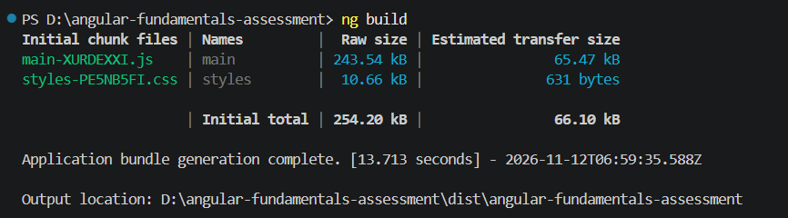
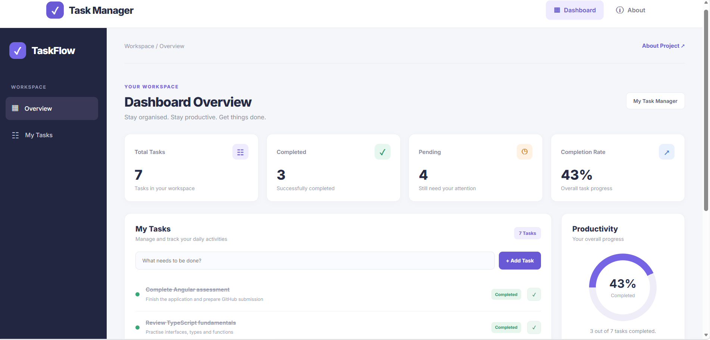
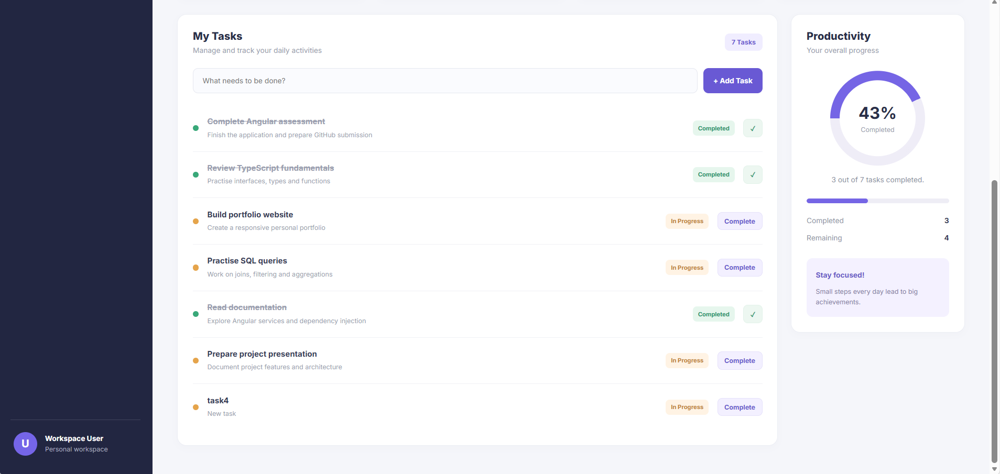
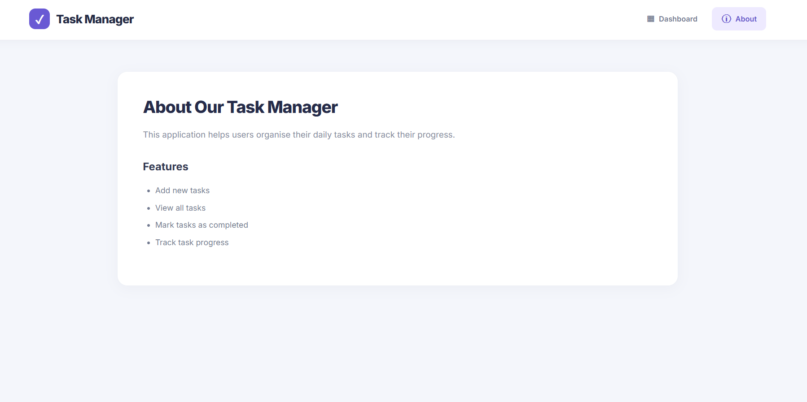

# Task Manager – Angular Fundamentals Assessment

A modern, responsive Task Management application built using Angular 21. The application allows users to organise daily activities, manage tasks, track completion status and monitor overall productivity.

## Project Overview

Task Manager is a single-page web application developed to demonstrate fundamental Angular concepts, including standalone components, component-based architecture, services, dependency injection, routing and modern Angular control flow.

The application provides an intuitive dashboard with task statistics and a productivity progress indicator.

## Features

- **Task Management:** Add and view tasks.
- **Task Completion:** Mark tasks as completed.
- **Progress Tracking:** Monitor completed and pending tasks.
- **Dashboard:** View total tasks, completed tasks, pending tasks and completion percentage.
- **Navigation:** Navigate between Dashboard and About pages.
- **Responsive Design:** Interface adapts to different screen sizes.

## Technologies Used

- Angular 21
- TypeScript
- HTML5
- SCSS
- Node.js
- Angular CLI

## Project Structure

```text
src/
└── app/
    ├── core/
    │   └── services/
    │       └── task.ts
    ├── features/
    │   ├── dashboard/
    │   │   ├── dashboard.ts
    │   │   ├── dashboard.html
    │   │   └── dashboard.scss
    │   └── about/
    │       ├── about.ts
    │       ├── about.html
    │       └── about.scss
    ├── models/
    ├── app.config.ts
    ├── app.routes.ts
    ├── app.ts
    └── app.html
```

## Angular Concepts Demonstrated

**1. Standalone Components**

The application uses standalone Angular components to organise the interface into independent and reusable sections.

**2. Services and Dependency Injection**

A task service manages task-related operations and is injected into the dashboard component using Angular dependency injection.

**3. Angular Routing**

Angular Router enables navigation between the Dashboard and About pages without reloading the entire application.

**4. Modern Control Flow**

Angular's built-in control-flow syntax, including `@for` and conditional rendering, is used to display task information dynamically.

**5. Component-Based Architecture**

The application separates its functionality into feature components, services and models to maintain a structured codebase.

## Installation and Setup

### Prerequisites

Make sure the following are installed:

- Node.js
- npm
- Angular CLI

### Step 1: Clone the repository

```bash
git clone https://github.com/siyaa10/angular-fundamentals-assessment.git
```

### Step 2: Navigate to the project directory

```bash
cd angular-fundamentals-assessment
```

### Step 3: Install dependencies

```bash
npm install
```

### Step 4: Start the development server

```bash
ng serve
```

Open your browser and navigate to:

http://localhost:4200/

The application will automatically reload when source files are modified.

## Production Build

To generate a production build, run:

```bash
ng build
```

The compiled application will be available in the `dist/` directory.

## Screenshots

### 1. Successful Production Build



### 2. Task Manager Dashboard and Control Flow





### 3. About Page – Second Route



## Author

Angular Fundamentals Assessment Project

---

Developed as part of an Angular fundamentals assessment.
